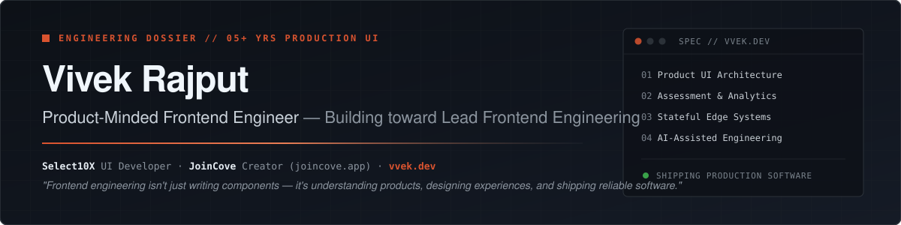
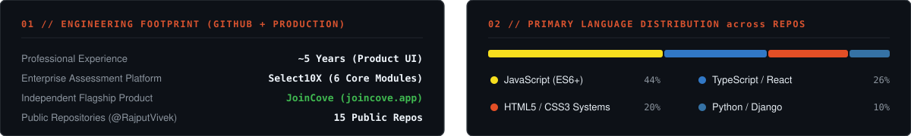

  <picture>
    <source media="(prefers-color-scheme: dark)" srcset="./assets/banner-dark.svg" />
    <source media="(prefers-color-scheme: light)" srcset="./assets/banner-light.svg" />
    
  </picture>

# Vivek Rajput — Product-Minded Frontend Engineer

I build production web interfaces, assessment platforms, analytics dashboards, and independent software products (~5 years of professional experience, transitioning toward **Lead Frontend Engineering**). My engineering philosophy is straightforward: **frontend engineering is not just about writing components—it is about understanding products, solving user and business problems, designing cohesive experiences, and shipping reliable software.**

  
  
  
  

---

## 01 // Engineering Focus & Production Experience

<table>
  <tr>
    <td width="50%" valign="top">
      <h3>Production UI Engineering — Select10X</h3>
      
As a <strong>UI Developer at Select10X</strong> (an AI-powered digital assessment platform), I architect and ship mission-critical interfaces across the core assessment lifecycle:

      <ul>
        <li><strong>Candidate Assessment Player:</strong> High-stakes test-taking interface built for reliability, clarity, and low cognitive friction.</li>
        <li><strong>10-Day GenAI-Assisted UX/UI Revamp:</strong> Led a comprehensive redesign of the Candidate Assessment Player using GenAI-assisted design workflows and structured prompting—approved by management and stakeholders and implemented into production UI in ~10 days.</li>
        <li><strong>Platform Ecosystem:</strong> Engineered core views for <em>Assessment Management</em>, <em>Question Bank</em>, <em>Self Assessment Portal</em>, and multi-dimensional <em>HR Analytics &amp; Reporting Dashboards</em>.</li>
      </ul>
      
<strong>Production Stack:</strong> HTML5 · CSS3 · JavaScript (ES6+) · jQuery · Bootstrap 4.6 · Django Templates · Chart.js · Highcharts

    </td>
    <td width="50%" valign="top">
      <h3>Independent Product Building &amp; Architecture</h3>
      
Beyond enterprise UI delivery, I design, architect, and ship independent software products from zero to production—owning product definition, UX design, frontend architecture, and edge infrastructure:

      <ul>
        <li><strong>End-to-End Product Execution:</strong> Turning product hypotheses into live, deployed applications (<a href="https://joincove.app">joincove.app</a>, <a href="https://vvek.dev">vvek.dev</a>).</li>
        <li><strong>Real-Time &amp; Stateful Edge Systems:</strong> Building low-latency WebSocket rooms and ephemeral state coordination on Cloudflare Durable Objects.</li>
        <li><strong>Interactive Data &amp; Geospatial UI:</strong> Translating telemetry, routing algorithms, and assessment metrics into clear visual interfaces.</li>
        <li><strong>AI-Augmented Engineering Workflows:</strong> Leveraging LLMs and local inference for rapid UI prototyping, edge-case auditing, and architecture iteration.</li>
      </ul>
      
<strong>Independent Stack:</strong> TypeScript · React · Next.js · Tailwind CSS · Vite · Cloudflare Durable Objects · Node.js · Python

    </td>
  </tr>
</table>

---

## 02 // Featured Independent Product & Selected Repositories

### Flagship Independent Product — [JoinCove (`joincove.app`)](https://joincove.app)

> **Private, ephemeral real-time communication platform built for zero-trace conversations.**

- **Product Architecture:** Designed around room-based ephemeral communication—no public directory, no social graph, and automatically expiring messages.
- **Real-Time Edge Infrastructure:** Powered by **Next.js**, **React**, **TypeScript**, **Tailwind CSS**, **Cloudflare Durable Objects**, and **WebSockets** for stateful, low-latency room synchronization and instant message expiration.
- **Explore:** [**Live Application (`https://joincove.app`)**](https://joincove.app) · [Early Prototype Repo (`lovers-chat`)](https://github.com/RajputVivek/lovers-chat)

 

<table>
  <tr>
    <td width="50%" valign="top">
      <h4><a href="https://github.com/RajputVivek/tp/tree/main/flight-price-intelligence">Flight Price Intelligence</a></h4>
      
Automated flight fare tracking service and alert pipeline. Built with a Python backend (<code>run_price_scan.py</code>), historical fare seeding, volatility evaluation, and automated alert bot daemons deployed on Linux systemd.

      
<code>Python</code> · <code>Automation</code> · <code>Price Tracking</code> · <code>Systemd</code>

    </td>
    <td width="50%" valign="top">
      <h4><a href="https://github.com/RajputVivek/trupath">TruPath — Geospatial Route Comparison</a> · <a href="https://trupath-seven.vercel.app">Live</a></h4>
      
Interactive mapping application that compares "strict" vs. "human" routing modes and direct geodesic distances using MapLibre GL and Geolib.

      
<code>React 19</code> · <code>TypeScript</code> · <code>Vite</code> · <code>MapLibre GL</code>

    </td>
  </tr>
  <tr>
    <td width="50%" valign="top">
      <h4><a href="https://github.com/RajputVivek/vvekv5">vvek.dev — Engineering Dossier &amp; UI Lab</a> · <a href="https://vvek.dev">Live</a></h4>
      
Personal engineering portfolio and interactive UI laboratory featuring live component playgrounds, Select10X &amp; JoinCove architectural case studies, and custom editorial design tokens.

      
<code>HTML5</code> · <code>CSS Custom Properties</code> · <code>Vanilla JS</code> · <code>Design Systems</code>

    </td>
    <td width="50%" valign="top">
      <h4><a href="https://github.com/RajputVivek/bhola">The Family Dental Care</a> &amp; <a href="https://github.com/RajputVivek/tomato-food">Tomato Food</a></h4>
      
Production multi-page healthcare appointment booking platform with interactive slot selection and REST admin views (<a href="https://github.com/RajputVivek/bhola"><code>bhola</code></a>), alongside a modular React + Vite food ordering frontend (<a href="https://github.com/RajputVivek/tomato-food"><code>tomato-food</code></a>).

      
<code>React</code> · <code>JavaScript</code> · <code>REST APIs</code> · <code>Responsive UI</code>

    </td>
  </tr>
</table>

---

## 03 // Technical Capabilities & Tooling

Organized by actual production depth versus independent application development and active exploration:

### Core Production Frontend (Daily Professional Use)

### Modern Frontend, Full-Stack & Edge (Independent Products & Active Builds)

### AI-Assisted Engineering & Creative Workflows
- **AI-Augmented Development & Debugging:** Daily engineering workflows accelerated with **Google Antigravity**, **Google Gemini**, and **ChatGPT** for architecture planning, complex debugging, and rapid implementation.
- **GenAI-Assisted UI Design:** Structured prompting and iterative design-to-code workflows (proven in the 10-day Select10X Candidate Assessment Player revamp).
- **Local Inference & Generative Media Experimentation:** Running local open-weight LLMs via **LM Studio** and experimenting with node-based image generation pipelines using **ComfyUI** and **Stable Diffusion**.

---

## 04 // Currently Exploring & Building Toward

- **Lead Frontend Engineering:** Scaling design systems, frontend architecture standards, and cross-functional product execution from discovery to shipping.
- **Stateful Edge & Real-Time Web:** Expanding **JoinCove** (`joincove.app`) capabilities over Cloudflare Durable Objects and WebSockets.
- **AI-Native Frontend Workflows:** Bridging high-craft UI engineering with deterministic LLM-assisted design and verification loops.

  
<strong>Engineering Footprint &amp; Language Distribution (Click to expand)</strong>

   
  

    <picture>
      <source media="(prefers-color-scheme: dark)" srcset="./assets/telemetry-dark.svg" />
      <source media="(prefers-color-scheme: light)" srcset="./assets/telemetry-light.svg" />
      
    </picture>
  

---

## 05 // Connect

I enjoy discussing frontend architecture, product design, assessment systems, and independent software building.

- **Portfolio & Case Studies:** [vvek.dev](https://vvek.dev)
- **Independent Product:** [joincove.app](https://joincove.app)
- **LinkedIn:** [linkedin.com/in/vivek-kumar-197564bb](https://www.linkedin.com/in/vivek-kumar-197564bb/)
- **Direct Email:** [hello@vvek.dev](mailto:hello@vvek.dev)

